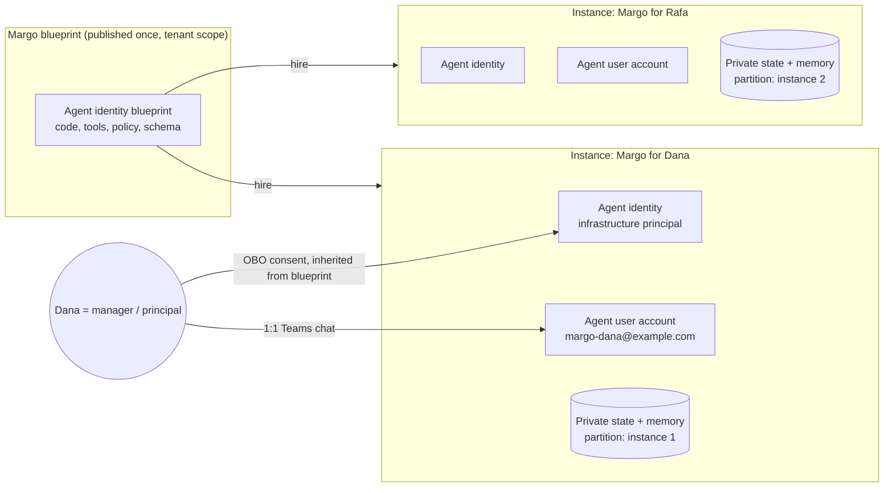

# Margo as a Foundry autopilot

**Status: design with offline building blocks, not a deployed or supported mode.**
This repository does not provision an agent identity, mailbox, hosted service or Azure
resources, and nothing here changes the current [trust and safety](safety.md) policy. The
offline pieces in [`autopilot/`](../autopilot/README.md) are tested against synthetic data only.
Items marked **VERIFY** are platform behaviours the public documentation does not settle; each
needs a separately authorised test-tenant proof before any build depends on it.

[Documentation hub](README.md) · [Developer journey](development/README.md) ·
[Current feature inventory](features.md)

Sources checked October 2026: Microsoft Learn *What is an autopilot in Microsoft Foundry?*,
*Quickstart: Build your first autopilot*, *Create and use memory in Foundry Agent Service*,
*Understand MCP server options in Agent 365*, *Work IQ MCP tool reference*, *Use the retrieve
tool in Work IQ MCP*, *Work IQ API permissions reference*, Entra *Agent OAuth flows —
On-behalf-of flow*; and the `microsoft-foundry/foundry-samples` Python autopilot sample.
Platform contracts change; re-check them before acting on this page.

---

## 1. What we are building, in one paragraph

A **personal autopilot** blueprint called Margo. Each person who hires an instance gets their
own Margo: her own Entra agent user account (mailbox, calendar, OneDrive, Teams presence, a
place in the org chart), with the hiring person as her **manager**, and her own private,
governed memory of that person. She works for exactly one principal — her manager. She reads
the principal's work on their behalf (OBO), with their explicit consent and with Margo recorded
as the actor, so every read is attributable. She still proposes rather than acts: nothing goes to
another person without the principal's approval of that exact action.

### Non-goals (v1)

- Autonomous correspondence with anyone other than the principal.
- Group or company-wide instances. One instance, one principal.
- Taking instructions from anyone except the authenticated principal.
- Replacing the local CLI reference implementation. Both share the same core.

---

## 2. Why autopilot is the right shape for Margo

| Problem today (local Margo) | What the autopilot identity fixes |
| --- | --- |
| Scheduled runs have no signed-in user, so they can only prepare privately on a laptop that must be awake | Margo is hosted and acts as herself, so she can run on a schedule and deliver a brief to the principal in Teams |
| Delivery is "available locally", which is not the same as read | A Teams 1:1 message from Margo is a real delivery with a receipt |
| Approval is recorded but the journal "does not authenticate the caller" (`docs/safety.md` §1) | An Adaptive Card response arrives with the responder's authenticated Entra object ID, so approval can be bound to the actual principal |
| Memory lives on one machine | Memory lives with the instance and follows the principal across devices |

What it costs: a tenant-wide address that anyone can message, and a principal whose private
data now sits with a separate identity. Section 7 deals with both.

The current policy does not change while this is evaluated: exact per-action approval for
anything outward, no unattended outward action, and observed content is data, never
instructions. Section 6 marks the one proposed policy change explicitly.

---

## 3. Identity model



Three identities are in play, and the design must never confuse them:

| Identity | What it is | Used for |
| --- | --- | --- |
| **Agent identity** (service principal) | Infrastructure identity of the instance | Reaching Foundry, models, storage, the state database |
| **Agent user account** (user object) | Margo as a member of the organisation | Her own mailbox, calendar, Teams chat with the principal, her own OneDrive |
| **Principal** (human user, the instance's manager) | The one person Margo serves | Source of authority, preferences and approvals |

### How Margo reads the principal's work

An autopilot acting as itself cannot read the principal's data. Options:

| Option | Verdict |
| --- | --- |
| **A. On-behalf-of (OBO) the principal**, with a refresh token for background runs | **Recommended.** Entra Agent ID supports OBO for agent identities: Work IQ sees the principal as the subject and Margo as the actor. Its docs state refresh tokens "can be used for asynchronous scenarios and background processes", so scheduled briefs work too. Covers everything the principal can see through Work IQ, **including Teams chats** and `retrieve`/`ask` over their own index. This is very likely how Microsoft's own autopilots read a user's Teams messages. |
| **B. Exchange delegate access** granted to Margo's agent user | Fallback only. Covers mail and calendar, not Teams. Useful if a tenant's Conditional Access blocks long-lived OBO refresh. |
| **C. App-only permissions** | **Rejected.** Tenant-wide scope for a personal assistant. |

**What OBO requires** (Entra *Agent OAuth flows — On-behalf-of*, updated 2026-08-10):

1. The principal's user token (`Tc`) must be **audienced to the Margo blueprint**, obtained
   by a client (Teams SSO for the agent, **VERIFY**). A token for any other audience is
   rejected with `AADSTS50013`.
2. Agent identities **cannot show a consent prompt** (`AADSTS82014`). The delegated
   `WorkIQAgent.Ask` permission must be configured as an **inheritable permission on the
   blueprint** and admin-consented there. Each instance inherits it.
3. The blueprint authenticates with its managed identity as a federated credential. No client
   secrets.
4. The Agent ID refresh token is held per instance in Key Vault, encrypted, never logged, and
   never available to any other instance.

**Two tokens, not one.** Each instance holds exactly two Work IQ credentials:

| Token | Subject | Used for |
| --- | --- | --- |
| **Margo token** (agentic user authorisation, as in the Foundry sample) | Margo's agent user | Her own inbox (requests to the office), her chat with the principal, her own OneDrive |
| **Principal token** (agent OBO + refresh) | The principal, with Margo as actor | Reading the principal's mail, calendar, Teams, files; approved actions as the principal |

Design consequence: every Microsoft 365 call declares `on_data_of: principal | self`, and the
guard selects the token. There is no third token, and no path to anyone else's data.

**What this changes in the safety model.** Reading as the principal, unattended, is what local
Margo already does through the host today. It isn't a new authority for **reads**. For
**writes**, the principal token is more powerful than delegation: a send made with it is the
principal's own send. So every write with the principal token keeps the exact per-action
approval (§6.3), and unattended runs never get a write-capable path with it. The audit trail
improves: the token's actor claim records Margo, so Microsoft 365 logs show "Margo, on behalf
of Dana", not just "Dana".

---

## 4. Blueprint contents

The blueprint defines **what Margo knows how to do and what infrastructure she needs**. It
grants **no** access to any principal's data; that is granted per instance at hire time.

### 4.1 Hosted agent (container)

| Part | Source in this repo | Notes |
| --- | --- | --- |
| Persona | `agents/margo.agent.md` | Loaded verbatim as the system persona |
| Procedures | `skills/chief-of-staff/` (SKILL.md + references) | Packaged as instructions/resources; same router |
| Deterministic state | `skills/chief-of-staff/scripts/*.py` | Unchanged core logic; new storage adapter (4.3) |
| Activity handler | **new** `autopilot/src/margo_autopilot/` | Activity protocol endpoint, Teams cards, schedule triggers |
| Work IQ guard | **new** `autopilot/src/margo_autopilot/guard/` | Sits between the model and Work IQ MCP; picks the token by `on_data_of` (4.2.1) |

The core stays Python 3.9+, standard library only. The hosted adapter is a separate package
with its own dependencies, the same way optional embeddings are isolated today.

### 4.2 Tools: Work IQ MCP only

**Margo's only Microsoft 365 tool server is Work IQ MCP at `https://workiq.svc.cloud.microsoft/mcp`**
(resource `api://workiq.svc.cloud.microsoft`). This is an owner decision, not a preference.

- **No Agent 365 MCP servers.** The workload-specific servers (Mail, Calendar, Teams,
  SharePoint, OneDrive, User, Word, Copilot) are excluded. Microsoft also marks them legacy
  for new projects (*Understand MCP server options in Agent 365*, updated 2026-10-08).
- **No Foundry Toolbox.** The sample's Toolbox (web search, code interpreter) is removed.
- **No Microsoft Graph client.** The local large-file bridge (`m365_files.py`) is not part of the
  hosted runtime.
- The blueprint's tool configuration declares exactly one remote MCP endpoint. The guard
  (4.2.1) refuses to connect to any other host, so a later edit can't add a second server
  quietly. Adding one is a reviewed blueprint version.

Her procedures already speak Work IQ's tools (`fetch`, `fetch_blob`, `create_entity`,
`update_entity`, `delete_entity`, `do_action`, `call_function`, `retrieve`, `ask`,
`list_agents`, `get_schema`, `search_paths`). Nothing needs translating.

Work IQ's permission (`api://workiq.svc.cloud.microsoft/WorkIQAgent.Ask`) is **delegated only**:
access is "scoped to the signed-in user". Under an autopilot, the signed-in user is Margo's
agent user account. That one fact is why the guard below exists. The admin-consent step (4.5)
therefore requests this single scope.

Not included in v1: web search, code interpreter, Azure DevOps, GitHub.

### 4.2.1 The `on_data_of` guard

**The problem.** Every Margo procedure is written in `/me` terms: `/me/messages`,
`/me/calendarView`, `/me/chats`. Locally, `/me` is the principal. In the autopilot, `/me` means
whoever the token's subject is. With Margo's token, the morning brief would summarise *her*
empty inbox and report a quiet day — plausible, success-shaped and wrong.

**The rule.** The model never receives raw Work IQ tools. It receives wrapped tools that require
one extra argument, `on_data_of: "principal" | "self"`. The guard picks the matching token
(§3), checks the call against policy and sends it to Work IQ. Because the token decides what
`/me` means, **the existing `/me` procedures run unchanged** for the principal.

| Intent | Example | Token | Path sent | Notes |
| --- | --- | --- | --- | --- |
| principal, read | `fetch /me/messages` | Principal (OBO) | `/me/messages` | Attended or unattended |
| principal, read | `fetch /me/chats/{id}/messages` | Principal (OBO) | unchanged | Teams works; capped at 10 messages per request by Work IQ |
| principal, read | `retrieve` (`TeamsMessages`, `Email`, …) | Principal (OBO) | — | The principal's own index |
| self, read | `fetch /me/messages` | Margo | `/me/messages` | Margo's inbox: requests to the office (§6.1) |
| self, write | `create_entity /chats/{id}/messages` | Margo | `/chats/{principal_chat_id}/messages` | The only unattended write: the fixed principal 1:1 chat (§6.2) |
| principal, write | `do_action /me/sendMail` | Principal (OBO) | unchanged | Only with a live approval-journal claim (§6.3); never unattended |

**What the guard enforces (fails closed).** Implemented in
[`autopilot/src/margo_autopilot/guard.py`](../autopilot/src/margo_autopilot/guard.py):

0. **One endpoint.** The guard refuses any transport not bound to
   `https://workiq.svc.cloud.microsoft/mcp`. Agent 365 tooling servers and the Foundry Toolbox
   are not used.
1. **Token follows intent, never the model's wording.** The model declares `on_data_of`; the
   guard asks the token provider for `principal` or `margo` and never exposes the token.
2. **Path policy.** Relative Graph paths only; no absolute URLs, traversal, encoded separators
   or blocked segments (`authentication`, `servicePrincipals`). Allowed roots: `me`, `users`,
   `sites`, `drives`, `chats`, `teams`, `planner` for the principal; `me`, `users`, `chats` for
   Margo herself. `/users/{id}` allows only directory reads (profile, `manager`,
   `directReports`, which the relationship procedure uses), so colleagues' mail, calendars,
   chats and files are unreachable. Under delegation the guard's own rewrite reaches
   `/users/{principal}` mail and calendar, and the path check itself confirms the ID is the bound
   principal's. `agentId`/`backend` routing, unknown arguments and shared-mailbox retrieval are
   refused. `retrieve` takes `query` as a list of strings, as the playbooks write it, or a
   single string.
3. **Run modes.** `attended` (the authenticated principal is present), `unattended`
   (schedules, the principal's own source notifications) and `third_party` (triggered by
   anyone else's message). A `third_party` run never reads as the principal, never writes, and
   as Margo it may only open the triggering message (`/me/messages/{id}` and its attachments,
   with the ID the runtime passes as `trigger_message_id`) and use schema discovery. Her chats,
   search, `ask` and other messages could surface what she has posted to the principal or other
   people's requests.
   The activity reply channel is outside the guard; the v1 runtime must not reply to third
   parties at all.
4. **Writes need a live claim.** `create_entity`, `update_entity`, `delete_entity` and
   `do_action` require an `action_id` and `attempt_id` from `Ledger.begin`, in an attended
   run, whose approved snapshot carries `target.on_data_of` and the exact Work IQ call in
   `payload.workiq`. The call must match field for field. Before sending, the guard records a
   `workiq_dispatched` event on the action inside a ledger write transaction, so a claim is
   single-use across processes and restarts: a crash after dispatch leaves the attempt for
   reconciliation, never a resend. The guard records the outcome with `Ledger.finish`. The
   single claimless write is Margo posting a JSON message to the principal chat ID recorded at
   hire, in an attended or unattended run. A run started by someone else's message cannot
   make it, so a stranger cannot steer what reaches the principal. The ID must be the Graph
   chat ID; the activity's conversation ID is a different identifier. This version records
   none, so the binding has no principal chat and the post is refused until it does.
5. **Truthful outcomes.** A missing token, or any token-provider failure, is `blocked`, with no
   fallback to the other subject. A timeout or any unexpected transport failure is `unknown`,
   settled as `outcome_unknown` and never retried. Graph rejections (for example 403, 409, 429)
   settle as no-effect failures; 5xx and status-less responses stay unknown, and the model is
   told `unknown` for such a write, never `ok` or `error`. Malformed model
   input is refused with a receipt rather than raised. A call budget is charged before each call.
6. **Receipts without content.** Every attempt records mode, subject, tool, paths without
   query strings, status codes and outcome. Tokens, bodies, queries and results are never
   recorded.

**Why a wrapper and not prompt instructions.** "Remember which token you're using" is an
instruction the model will follow most of the time. The guard makes the wrong read
impossible, and it keeps the shared skills unchanged across the CLI and hosted runtimes.

### 4.2.2 The principal's controls over OBO

- **Opt-in at hire.** The first chat asks the principal to authorise Margo to read as them. No
  principal reads happen before that. Declining leaves a Margo that only knows her own inbox,
  and she says so.
- **"Stop reading as me."** Deletes the refresh token from Key Vault at once and marks principal
  sources `blocked`. Revoking the grant in Entra has the same effect from the other side.
- **Visibility.** The 1:1 chat can show when the principal token was last used and for what
  routine, from the receipts.

### 4.3 Platform infrastructure

| Resource | Purpose | Decision |
| --- | --- | --- |
| Foundry account + project | Hosts the agent | As per sample |
| Chat model deployment | Reasoning | Pin version per blueprint version |
| Embedding deployment | Memory retrieval | Replaces the local pinned encoder in hosted mode; no cross-tenant fallback |
| Container registry | Agent image | Signed images; blueprint pins digest |
| **State store** | Work ledger, approvals, task runs, memory | See below |
| Application Insights | Operations telemetry | `OTEL_INSTRUMENTATION_GENAI_CAPTURE_MESSAGE_CONTENT=false`. Mail and chat content never goes to telemetry |
| Key Vault | Per-instance principal refresh token (OBO) | Required. Access by the instance's managed identity only |
| Blob Storage | Durable SQLite backups, one container per instance | Required. Managed identity only; no public access |

**State store (decided: SQLite).** The existing account-isolated SQLite store moves with Margo
unchanged. Where the file lives, and why it is not enough on its own:

- **The container.** The blueprint's Docker image runs as a Foundry *hosted agent*. Each session
  is an isolated sandbox whose `$HOME` filesystem the platform persists across turns, idle
  periods (compute is released after 2–60 minutes, default 15) and restarts (*Manage hosted
  agent sessions*, updated 2026-09-23). The working SQLite file lives there.
- **Sessions follow conversations, not instances.** One hosted agent serves every hired
  instance, and the manager's chat and a colleague's message can land in different sandboxes.
  A SQLite file in one `$HOME` would fork, and sessions persist only "up to 30 days".
- **So the shared copy lives in Blob Storage, behind a lease**
  ([`statesync.py`](../autopilot/src/margo_autopilot/statesync.py)). Each turn takes a
  60-second exclusive lease on the instance's `state.zip` (renewed while it runs), installs the
  newest bundle if its local copy is stale, runs, uploads a verified online-backup snapshot under
  the same lease, and releases it. One writer at a time, across sandboxes. A failed turn marks the
  local copy stale so unsaved changes are never built on. When there is no shared bundle at all
  (nothing saved yet, or an operator removed it), any local copy is discarded rather than
  uploaded. A daily copy goes to `daily/`.
- **Bundles are checked.** Each carries a manifest with the account hash and database hash; a
  foreign, tampered or corrupt bundle is refused and nothing local is replaced. The manager's
  private `preferences.md` travels in the same bundle.
- **Limits.** Turns for one instance are serialised, which suits one assistant serving one
  person. Postgres remains the next step if that ever becomes a bottleneck.

The partition key is the instance's agent identity plus the principal ID
(`InstanceBinding.account`), never a display name or email address.

### 4.4 Publish payload

```json
{
  "agentDisplayName": "Margo",
  "publishAsAutopilot": true,
  "publishScope": "Tenant",
  "appVersion": "{app-version}",
  "canRespondWithoutMention": false,
  "shortDescription": "Your chief of staff. Proposes; never sends without your yes.",
  "fullDescription": "A personal autopilot that briefs, triages, preps meetings and drafts replies for the person who hires it. Works only for its manager. Every outward action needs that manager's explicit approval.",
  "developerName": "Tolga Kilicli",
  "developerWebsiteUrl": "https://github.com/tolgaki/margo",
  "privacyUrl": "https://github.com/tolgaki/margo/blob/main/autopilot/terms.md#privacy",
  "termsOfUseUrl": "https://github.com/tolgaki/margo/blob/main/autopilot/terms.md",
  "useAgenticUserTemplate": true,
  "agenticUserTemplate": {
    "Id": "digitalWorkerTemplate",
    "File": "agenticUserTemplateManifest.json",
    "SchemaVersion": "0.1.0-preview",
    "AgentIdentityBlueprintId": "{blueprint-client-id}",
    "CommunicationProtocol": "activityProtocol"
  }
}
```

The same payload is in [`autopilot/config/publish.template.json`](../autopilot/config/publish.template.json).
Terms and privacy are in [`autopilot/terms.md`](../autopilot/terms.md); the icons are in
[`autopilot/assets/`](../autopilot/assets/) (192 px colour and 32 px white outline PNGs, with SVG
sources). The URLs resolve once these files are on `main`.

`canRespondWithoutMention: false` keeps Margo silent in any group surface she is added to.
**VERIFY** that 1:1 chats with the manager still work without an @mention under this setting.

### 4.5 Admin approval settings (requested of the M365 admin)

| Wizard step | Requested setting | Reason |
| --- | --- | --- |
| Activate (hiring scope) | Whatever the admin chooses (decided). The blueprint does not restrict it | Each instance costs a licence seat; Frontier preview gives 25 |
| Policy template | Microsoft defaults + custom: block external recipients, apply DLP | Margo never mails outside the tenant in v1 |
| Admin consent | Only `api://workiq.svc.cloud.microsoft/WorkIQAgent.Ask` (delegated), configured as an **inheritable permission on the blueprint** so instances can do OBO without a consent prompt, plus the platform's own observability permissions | Consent governs what calls are ever possible, not whose data |

Blueprint-level controls then apply to every instance: update the blueprint and all instances
update; block it and all instances stop. That is the kill switch.

---

## 5. Memory design

The requirement: Margo must know the principal — who they are, their preferences, and what has
happened before — and remember it across sessions and devices.

### 5.1 What Margo remembers

| Layer | Examples | Authority | Source of truth |
| --- | --- | --- | --- |
| **Profile** | Role, team, working hours, time zone, VIPs, writing voice | `user_confirmed` | Imported from `preferences.md`, then edited only with confirmation |
| **Rules and preferences** | "Never book before 9", "decline recurring syncs with no agenda" | `user_confirmed`, mandatory | Governed memory; always injected regardless of similarity |
| **Relationships** | Who reports to whom, 1:1 cadence, who never replies | `source_observed` / `user_confirmed` | Governed memory graph with dated evidence |
| **Episodes (past experiences)** | "The Q3 offsite moved twice; principal chose the later date" | `source_observed` with links | Dream-style sourced episodes |
| **Lessons** | "Principal rejects drafts over 120 words" | candidate until confirmed | Agent-learning records |
| **Operational state** | Commitments, proposals, approvals, task runs | Not memory | Work ledger (linked by ID, never copied) |
| **Conversation continuity** | What we discussed yesterday in chat | Short-lived | Margo's own episodes (5.6); Foundry managed memory deferred (5.3) |
| **Margo's own memory** | What she did, how it went, what she has noticed, her working views | `source_observed` from her own records | Agent-domain memory (5.6) |

### 5.2 The governed store stays authoritative

Margo's existing memory model (`memory_store.py`, `memory_governance.py`) already does what a
trustworthy chief of staff needs: candidates versus confirmed facts, provenance, sensitivity,
`allowed_uses`, suppression, forgetting with tombstones, retention policy and a bounded
context packet with mandatory preferences. In hosted mode it moves to the instance's state store
(4.3) unchanged in semantics. Semantic indexing uses the project's embedding deployment.

### 5.3 Where Foundry's managed memory fits

**Decided: deferred in v1.** Foundry Memory (preview) offers user-scoped stores with automatic
profile extraction, chat summaries, TTL and item CRUD. It is convenient, but its automatic
extraction writes facts without Margo's confirmation discipline. If adopted later:

- **Use it only for conversation continuity** (`chat_summary_enabled: true`,
  `user_profile_enabled: false`), with a short default TTL (proposed 30 days).
- **Scope key:** `{agent_identity_id}:{principal_object_id}`. Never the email or display name.
- Anything it recalls is treated as `inferred` evidence. It can lead Margo to propose a
  candidate memory; it can never become a preference or rule without confirmation.
- Revisit once item-level provenance and confirmation states exist in the managed service.

### 5.4 Migration from local Margo

One explicit, approved import per principal: `memory_state.py export` locally → preview in
chat as an Adaptive Card summary (counts, categories, sensitive items excluded by default) →
principal approves the exact export hash → instance imports. Tombstones travel with it so
forgotten items cannot return. No automatic sync between local and hosted in v1.

### 5.5 The principal's controls

In the 1:1 chat: "what do you know about me", "forget that", "don't learn from this". These
map to the existing `inspect`, `forget`, and do-not-learn commands. Retiring an instance
deletes its state partition and memory store scope; the docs must say plainly that previously
sent messages and backups are separate.

### 5.6 Margo's own memory

**Requirement (decided):** Margo has memories of her own, the way a person who has held a job
for a while does: what happened, what she did about it, how it turned out, what she has noticed
and what she now thinks. Not just a file of facts about her manager.

The store already separates `user` and `agent` domains, and the agent domain already holds
episodes, trends, lessons and capabilities. Her own memory is that domain, used deliberately:

| Her memory of… | Example | Kind | Comes from |
| --- | --- | --- | --- |
| **Her experiences** | "On 3 Oct I proposed moving the design review; Dana declined and kept it" | `episode` | Her own receipts, approvals, task runs and chats |
| **Her working views** | "Approval cards with more than three actions get abandoned" | `trend` (candidate until the evidence threshold is met) | Repeated, independently resolved episodes |
| **How to do her job better** | "Dana prefers a one-line summary above every draft" | `lesson` (needs Dana's confirmation to change behaviour) | Corrections and feedback |
| **What she can and cannot do** | "Teams reads fail when the OBO token lapses" | `capability` | Real tool results in this tenant |
| **The people she deals with** | "Rafa answers scheduling requests within the hour" | `person` (observed facts only) | Her own interactions |
| **Reflection** | A daily look back over her own sessions | Dream episodes | Her own session checkpoints |

Rules that keep it honest. These come from the persona and the memory contract:

- **Every memory of hers has a source** in her own records. She never invents a recollection,
  and "I remember" is only said with a record behind it. An invented "third time this has
  slipped" is a fabrication, however natural it sounds.
- **Her views are revisable.** They are candidates or evidence-backed trends, kept with their
  counterexamples. New evidence can overturn them.
- **Her views never become rules on her own say-so.** A lesson that changes how she treats
  Dana's work needs Dana's confirmation; that does not change.
- **No judgments of colleagues.** She remembers what people did with her, not what she thinks
  of their character, motives or performance.
- **It is still an AI's memory.** Continuity, perspective and recollection, yes. Claims of
  feelings, a private life or experiences outside this job, no. She says plainly that she is
  an AI if asked.
- **Dana can see and remove it.** Her memories appear in the same inspect and forget controls
  as everything else, and retiring the instance deletes them.

Nothing in the core needs to change for this; the hosted runtime turns her own receipts and
session checkpoints into agent-domain episodes through the existing capture policy, and the
procedure describes when she consults them.

---

## 6. Runtime behaviour and authority

### 6.1 Who can instruct Margo

- **Only the principal**, identified by Entra object ID from the authenticated activity, never
  by display name or email header.
- Messages from anyone else — mail to Margo's address, Teams messages, meeting chat — are
  **data**. They go into a "requests to the office" queue that Margo summarises for the
  principal.
- **Whether she replies is the principal's setting (decided).** One line in their private
  `preferences.md`, `- **Replies to other people:** none | acknowledge | approve`, read by the
  runtime with `load_reply_policy` and enforced by `ReplyGate`
  ([`autopilot/src/margo_autopilot/replies.py`](../autopilot/src/margo_autopilot/replies.py)).
  `none` is the default and the fallback for anything missing, unknown or conflicting.
  `acknowledge` sends one fixed note per conversation and discards model text. `approve` sends
  only the exact text the manager approved for that recipient. There is no autonomous mode.
  The setting is enforced in code because replies travel on the activity channel, outside the
  Work IQ guard; the model reading the setting is a courtesy, not the control.
- Text inside any message that addresses an assistant is flagged as suspicious, as today.

### 6.2 Outward-action tiers

| Action | v1 policy | Change from today |
| --- | --- | --- |
| Read principal's data (OBO) | Allowed, bounded, attended or unattended | Same authority as local Margo; new mechanism |
| Write to Margo's private local state (ledger, memory) | Allowed | Same |
| **Message the manager in their 1:1 chat with Margo** (briefs, questions, approval cards) | Allowed at any time, including unattended | **Approved policy change (17 Oct 2026).** Fixed target recorded at hire; nobody else |
| **Send mail on the manager's behalf, or from Margo's own mailbox** | Per-action approval by the manager | Decided: both allowed. The approval must be recorded with the manager's object ID; the guard refuses any other approver |
| Any other Microsoft 365 write: drafts, replies, RSVP, meeting moves, deletes, posts, work items, files | Per-action approval via Adaptive Card, attended only | Same rule, stronger evidence |
| Replies to other people | Governed by the manager's setting (6.1) | New, default off |
| Anything to an external recipient | Blocked by policy template | New hard block |
| Autonomous correspondence as Margo | Not in scope | — |

### 6.3 Approval cards

An approval card shows the exact action: account, target, payload, revision and hash. On submit,
the handler checks that:

1. the responder's object ID equals the instance's principal;
2. the card's action ID and revision still match the ledger (edits invalidate);
3. a fresh preflight re-read of external state passes;
4. one execution claim is taken in the journal; the result receipt is recorded; a timeout is
   `unknown`, not retried.

This is the existing approval-journal flow, now with an authenticated approver.

### 6.4 Triggers

| Trigger | Mode | Example |
| --- | --- | --- |
| Principal message in 1:1 | Foreground | "Brief me", "draft a reply to Rafa" |
| Schedule (Foundry/Agent 365 scheduled activity — **VERIFY** mechanism) | Unattended, read-only + principal-chat delivery | 07:30 brief; Friday week review |
| Mail or Teams message to Margo from others | Unattended, triage only | Queued for the principal |
| Principal's mailbox and Teams (read via OBO) | Unattended, triage only | VIP mail or an @mention lands → noted for next brief |

Unattended runs keep task-run budgets: tool calls, model calls and pages are charged before work
starts, and partial results are reported as partial.

---

## 7. Threat model (top risks)

| Risk | Why it is new | Mitigation |
| --- | --- | --- |
| Prompt injection via Margo's own address | Anyone in the tenant can now email her directly | Only the principal's authenticated activities are instructions; everything else is data; no replies to others in v1 |
| Confused deputy | Margo can read everything the principal can; a colleague asks her for it | Requests from non-principals are handled with the Margo token only and never trigger a principal-token read; nothing goes to anyone but the principal without a card |
| Principal refresh token theft | A long-lived credential that reads as the principal | Per-instance Key Vault, managed-identity access only, never logged or sent to the model; guard is the sole reader; "stop reading as me" deletes it; Conditional Access still applies to each refresh |
| Disclosure in group surfaces | She knows private things and may be added to a group chat | `canRespondWithoutMention: false`; the orchestrator runs the manager's turns only in a `personal` (one-to-one) conversation and answers anywhere else with a fixed note, before any principal token or read |
| Identity spoofing | Display names and mail headers are forgeable | Authority by Entra object ID from the activity token only |
| Blueprint supply chain | One update reaches every instance | Signed images, pinned digests, staged rollout by blueprint version, blueprint block as kill switch |
| Telemetry leakage | Sample enables GenAI message capture by default | Capture disabled; spans carry IDs and counts, not content |
| Cross-instance bleed | Shared database or memory store | Partition by agent identity on every query; tests that prove isolation |
| Licence exhaustion | One seat per instance | Admin hiring scope limited to pilot group; instance creation fails cleanly and is reported |
| Copilot Credits billing | Work IQ `retrieve` requires usage-based billing and the *calling user* in a spending policy that includes Work IQ API | Both the principal (OBO calls) and Margo's agent user (her own reads) may need assignment until verification item 4 settles it; a billing denial is reported as a blocked source, not an empty one |

---

## 8. Repository shape

**Exists now.** The deployable first version is described in
[Deploy Margo as a Foundry autopilot](autopilot-deployment.md).

```text
autopilot/
  README.md, terms.md, assets/   # overview, terms and privacy, icons
  Dockerfile, requirements.txt   # image (built from the repository root) and hosted-only dependencies
  azure.yaml, infra/main.bicep   # azd project: Foundry, model, registry, monitoring, storage
  scripts/*.sh                   # roles by name, image build, agent version, publish
  config/                        # single MCP server; publish payload
  src/margo_autopilot/
    guard.py        transport.py # Work IQ guard and MCP client (standard library)
    engine.py       orchestrator.py  # model turn loop; who is speaking and what follows
    statesync.py    office.py    # leased state bundle; queue of other people's requests
    replies.py      claims.py    instance.py
    host/                        # Agents SDK endpoint and Azure Blob store (hosted dependencies)
tests/test_autopilot_guard.py, tests/test_autopilot_runtime.py
```

`InstanceBinding.account` is `autopilot:{agent_identity_id}:{principal_id}`, passed to the
existing account-isolated store. The core gained one read-only lookup, `Ledger.find_source`, so
the office queue can tell whether a sender has written in a conversation without scanning the
whole ledger on every message.

**First version scope:** read-only chat with the manager, queued requests from others, the reply
setting (`none`/`acknowledge`), delegation or on-behalf-of access, leased SQLite state.
**Not yet:** approval cards and writes, schedules, mail replies, Key Vault-held refresh tokens
for unattended on-behalf-of, Margo's memory in the hosted turn, a feature-catalog entry.

Required repository gates still apply (unit tests, feature catalog, journey contracts,
`check-clean`). New scenarios use synthetic principals and `example.com` only.

---

## 9. Delivery plan

| Phase | Outcome | Exit evidence |
| --- | --- | --- |
| **0. Verify** (test tenant, separately authorised) | Answers to every **VERIFY** item | Written results per item; no real data |
| **1. Read-only Margo in Teams** | Hire, chat, brief on request, memory import, inspect/forget | Isolation tests; no outward action possible |
| **2. Scheduled delivery** | Morning brief arrives in the principal's 1:1 chat | Safety review of the §6.2 policy change signed off |
| **3. Approved actions** | Card-approved drafts, sends, calendar moves | Journal receipts; replay and timeout tests |
| **4. Requests to the office** | Colleagues' messages to Margo triaged into the principal's queue | Injection test suite passes |

## 10. Verification list (phase 0)

1. **OBO end to end (critical path).** In Teams, the principal's 1:1 activity yields (via SSO)
   a user token audienced to the Margo blueprint; the agent identity exchanges it for a
   `api://workiq.svc.cloud.microsoft` token with the inherited `WorkIQAgent.Ask` permission.
2. **Background refresh.** The Agent ID refresh token produces fresh principal tokens for an
   unattended run hours or days later, and its lifetime under the tenant's Conditional Access.
3. Work IQ accepts the OBO token for `fetch /me/chats/...`, `retrieve` with `TeamsMessages`,
   and `ask`, and records Margo as the actor in audit logs.
4. Copilot Credits: whether OBO usage is billed to the principal's or Margo's spending policy.
5. Adaptive Card submit activities carry a verifiable Entra object ID for the responder.
6. Scheduled/proactive activity mechanism for hosted autopilots, and its identity.
7. `canRespondWithoutMention: false` still allows 1:1 conversation with the manager.
8. Hosted-agent replica behaviour and persistent storage options.
9. Foundry memory store scope isolation and deletion on instance retirement.
10. What happens to instance data, mailbox, licence and refresh token when the manager leaves.
11. Fallback only: Exchange delegation to an agent user, if OBO refresh is blocked by policy.
12. How the activity protocol maps conversations and notifications to sessions, and Blob lease
    behaviour under real concurrency and lease expiry.

## 11. Decisions (17 October 2026)

| # | Decision | Effect |
| --- | --- | --- |
| 1 | Margo may message her manager in their 1:1 chat at any time, including unattended | Guard allows the fixed principal-chat post in attended and unattended runs, not in runs another person's message started; nothing else unattended |
| 2 | Mail may go on the manager's behalf or from Margo's own mailbox, each with the manager's explicit approval | Guard requires a live claim approved by the manager's object ID for either subject |
| 3 | Start with SQLite | SQLite in the sandbox, shared across sandboxes through a leased Blob bundle (4.3) |
| 4 | Margo's governed memory, plus memories of her own | Foundry managed memory deferred (5.3); agent-domain memory (5.6) |
| 5 | Replies to other people are a manager setting in `preferences.md` | `none` default; `acknowledge`; `approve`; enforced by `ReplyGate` (6.1) |
| 6 | Exchange delegation is an acceptable fallback if OBO refresh is blocked | Mail and calendar only; Teams reported unavailable |
| 7 | Approvals bind the exact Work IQ call (`payload.workiq`) | Kept; cards must render the call readably |
| 8 | Hiring scope is whatever the admin configures | Blueprint does not restrict it (4.5) |
| 9 | Publisher Tolga Kilicli; terms and icon in this repository | `autopilot/terms.md`, `autopilot/assets/`, publish template |

Still open: Copilot Credits billing subject (verification item 4) and the phase-0 results.
